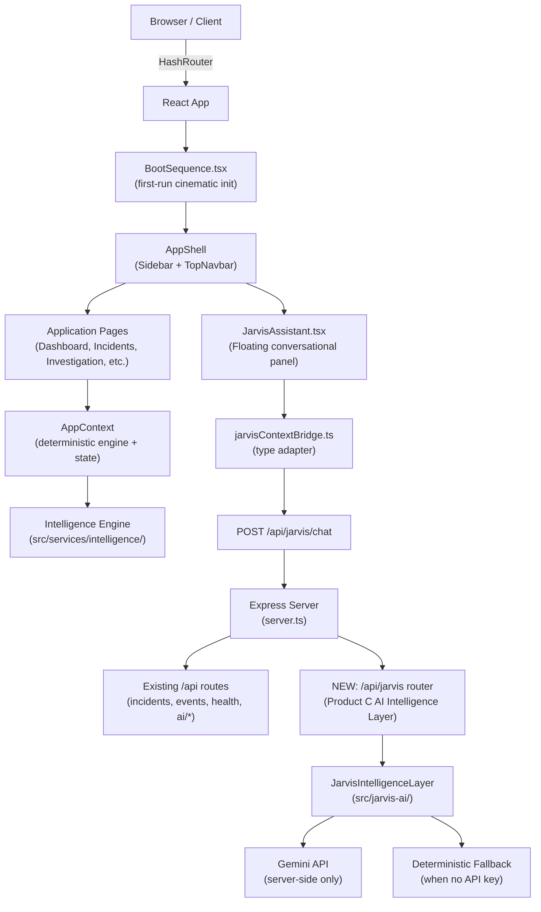

# J.A.R.V.I.S. — Final Integration Handoff

> **Status:** ✅ COMPLETE — All three products integrated. Build passing. 47/47 tests passing.

---

## Architecture Overview



---

## Products Integrated

| Product | Location | Status |
|---------|----------|--------|
| **A** — Core App (deterministic engine + backend) | `jarvis/` root | ✅ Existing |
| **B** — Finalized Frontend (Three.js, design system) | `src/` within Product A | ✅ Previously integrated |
| **C** — Google AI Studio Intelligence Module | `src/jarvis-ai/` | ✅ **Now integrated** |

---

## New Files Created

| File | Purpose |
|------|---------|
| `src/components/boot/BootSequence.tsx` | Cinematic system initialization sequence |
| `src/components/common/JarvisAssistant.tsx` | Floating conversational AI assistant panel |
| `src/services/jarvisContextBridge.ts` | Type adapter: `Incident` → `IncidentContext` |
| `src/jarvis-ai/` (14 files) | Complete AI Intelligence Layer (Product C) |
| `src/jarvis-ai/integration/expressRouter.ts` | Express router for `/api/jarvis/*` endpoints |

## Modified Files

| File | Change |
|------|--------|
| `src/App.tsx` | Added `BootSequence` (session-gated) + `JarvisAssistant` in AppShell |
| `server.ts` | Mounted `createJarvisRouter()` at `/api/jarvis` |
| `src/pages/Settings.tsx` | Added "Replay Boot Sequence" button |

---

## Boot Sequence Timing

```
STAGE 1 — INITIALIZING J.A.R.V.I.S.          ~900ms   Always OK
STAGE 2 — LOADING CORE INTELLIGENCE           ~800ms   Always OK
STAGE 3 — ESTABLISHING SYSTEM INTERFACES     ~1000ms   Real fetch('/api/health')
STAGE 4 — INITIALIZING VISUAL SYSTEM          ~700ms   Real WebGL canvas check
WORDMARK  — Sequential letter illumination    ~1680ms   J→A→R→V→I→S
ALIVE     — "J.A.R.V.I.S. IS ALIVE."         ~1400ms   Declaration hold
FADEOUT   — Smooth opacity transition          ~600ms   Into dashboard
─────────────────────────────────────────────────────────
Total: ~7 seconds  |  Skip button: after 1s  |  Failsafe: 10s
```

> [!IMPORTANT]
> Backend/WebGL statuses show REAL results — `DEGRADED` if `/api/health` returns non-2xx, `ERROR` if WebGL unavailable. Never fakes "initialized."

---

## AI Intelligence Layer: `/api/jarvis` Endpoints

| Method | Endpoint | Description |
|--------|----------|-------------|
| `GET` | `/api/jarvis/health` | Module health + mock mode status |
| `POST` | `/api/jarvis/context/validate` | Validate IncidentContext without calling Gemini |
| `POST` | `/api/jarvis/explain/root-cause` | Explain deterministic RCA decision |
| `POST` | `/api/jarvis/interpret/evidence` | Group evidence, identify temporal sequence |
| `POST` | `/api/jarvis/analyze/contradictions` | Challenge hypothesis with conflicting data |
| `POST` | `/api/jarvis/explain/impact` | Blast-radius propagation narrative |
| `POST` | `/api/jarvis/recommendations` | Prioritized actions (immediate/investigation/recovery/preventive) |
| `POST` | `/api/jarvis/report` | 11-section formal post-incident report (JSON + Markdown) |
| `POST` | `/api/jarvis/chat` | **Conversational assistant** (grounded Q&A) |
| `POST` | `/api/jarvis/analyze/full` | All 6 engines concurrently |

---

## Conversational Assistant ("Ask J.A.R.V.I.S.")

- **Trigger:** Floating cyan `✦ Ask J.A.R.V.I.S.` button — bottom-right of all app screens
- **Context:** Automatically uses `selectedIncident` from `AppContext` via `jarvisContextBridge.ts`
- **Backend:** `POST /api/jarvis/chat` → `JarvisConversationalAssistant`
- **Fallback:** Deterministic rule-based answers when Gemini is offline (no API key)
- **Grounding:** Hallucinated evidence IDs filtered; only context-valid services cited
- **History:** Last 6 message pairs passed for multi-turn context

---

## Environment Variables

```env
# Required for live Gemini intelligence (server-side only — never in browser bundle)
GEMINI_API_KEY=your_key_here

# Optional
JARVIS_MODEL_NAME=gemini-2.5-flash   # or gemini-3.8-flash
JARVIS_TIMEOUT_MS=25000
PORT=3000
```

---

## Startup

```bash
cd C:\Users\praty\.gemini\antigravity\scratch\jarvis
npm run dev        # Dev server on :3000 (Express + Vite)
npm test           # 47 tests
npm run build      # Production bundle
```

**Verify endpoints:**
- `GET :3000/api/health` → `{ status: "ok" }`
- `GET :3000/api/ai/status` → `{ geminiConfigured: bool }`
- `GET :3000/api/jarvis/health` → `{ status: "UP", mockMode: bool }`

---

## Test Results

```
Intelligence Engine:    13/13  ✅
Gemini Integration:      6/6   ✅
Telemetry Ingestion:    13/13  ✅
Backend API:            15/15  ✅
─────────────────────────────
TOTAL:                  47/47  ✅

Production build:  892ms, 0 errors, 17 chunks  ✅
TypeScript:        0 errors  ✅
```

---

## Grounding Guarantees

1. **Evidence ID integrity** — `StructuredResponseValidator` removes any Gemini-cited evidence IDs not present in the input
2. **Service containment** — Only services from the incident context can be named
3. **Deterministic preservation** — AI layer explains the upstream RCA decision; never overrides it
4. **Limitation acknowledgment** — Unmeasured telemetry is explicitly noted as "unrecorded"
5. **No faked executions** — All remediation steps carry `requiresOperatorApproval: true`

---

## Known Limitations

- Boot sequence wordmark uses CSS text animation (not Three.js canvas) during init for performance; full Three.js experience loads in LandingPage as designed
- `JARVIS_MODEL_NAME` defaults to `gemini-3.8-flash` (AI module spec); set to `gemini-2.5-flash` to match the existing `/api/ai/synthesize` route
- `/api/jarvis/*` uses `IncidentContext` schema; `/api/ai/synthesize` uses `IncidentSynthesisPayload` — both coexist serving different layers

---

*Generated: 2026-11-09 · Conversation d8cb79f5*
