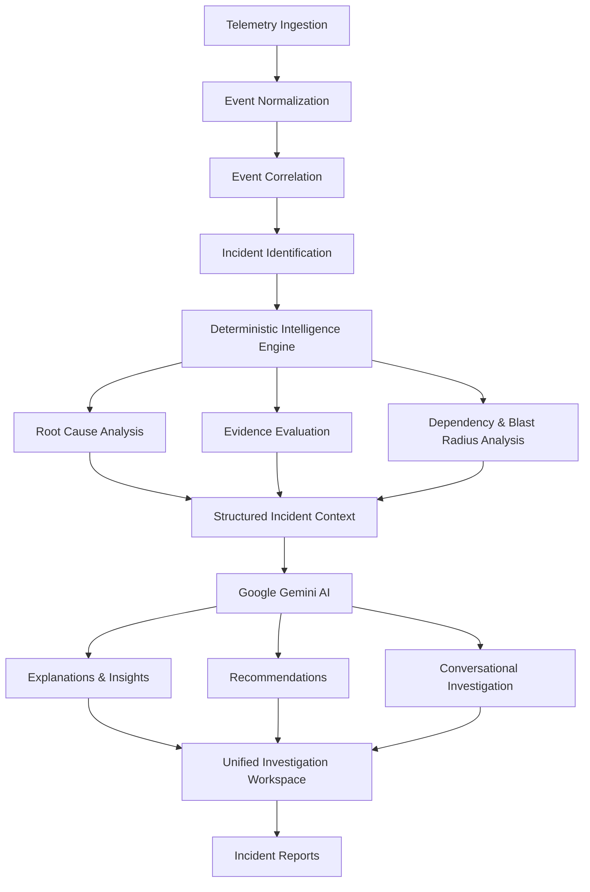

# J.A.R.V.I.S.
### From Incident Noise to Engineering Clarity.

**AI-Powered Incident Intelligence & Root Cause Analysis**

<br/>


<br/>

**[Explore the AI Studio App](https://ai.studio/apps/52b1356c-b416-41cf-b18f-44ae1f278417)**

</div>

---

## 01. The Vision

Modern software systems generate enormous volumes of logs, events and telemetry. When something goes wrong, engineers are often left navigating thousands of disconnected signals to identify what actually happened.

**J.A.R.V.I.S. changes that.**

J.A.R.V.I.S. is an AI-powered incident intelligence platform that transforms fragmented system telemetry into correlated incidents, evidence-backed root cause analysis and actionable operational intelligence.

By combining a deterministic intelligence engine with Google's Gemini AI, J.A.R.V.I.S. helps engineering teams move beyond simply detecting failures to actually understanding them.

> Don't just detect the incident. Understand the incident.

---

## 02. What Makes J.A.R.V.I.S. Different?

| Capability | What it does |
|---|---|
| Intelligent Ingestion | Processes CSV and JSON telemetry |
| Event Correlation | Identifies relationships between disconnected events |
| Root Cause Analysis | Ranks potential causes using deterministic reasoning |
| Evidence Intelligence | Identifies supporting and contradictory evidence |
| Blast Radius Analysis | Evaluates affected services through dependency relationships |
| Gemini Intelligence | Explains findings and generates contextual recommendations |
| Investigation Assistant | Allows users to interact with incident context |
| Report Generation | Converts investigation findings into structured reports |

---

## 03. The Intelligence Pipeline

J.A.R.V.I.S. follows a structured workflow that transforms raw telemetry into actionable engineering intelligence.



### The Core Principle

**Deterministic intelligence decides. Generative AI explains.**

The deterministic engine remains responsible for critical analytical operations, including event correlation, root-cause selection, evidence identification and blast-radius calculations.

Gemini enhances these results through contextual explanations, evidence interpretation, recommendations and conversational assistance.

This separation helps maintain analytical consistency while benefiting from generative AI.

---

## 04. Inside the Platform

### Telemetry Ingestion
- CSV and JSON data ingestion.
- Event normalization and validation.
- Timestamp processing.
- Service alias resolution.
- Structured event representation.

### Incident Intelligence
- Automatic event correlation.
- Incident clustering.
- Root-cause candidate ranking.
- Supporting and contradictory evidence evaluation.
- Incident timeline generation.
- Dynamic re-analysis when new evidence arrives.

### Gemini AI Intelligence
- Natural-language root-cause explanations.
- Evidence interpretation.
- Contradiction analysis.
- Context-aware recommendations.
- Service impact explanations.
- Incident-aware conversational assistant.
- Structured report generation.

### Investigation Workspace
- Dashboard.
- Incident Explorer.
- Event Explorer.
- Investigation Mode.
- Root Cause Analysis.
- Evidence Inspection.
- Service Dependency Map.
- Blast Radius Visualization.
- Reports and Exports.

---

## 05. The J.A.R.V.I.S. Identity

The name represents six fundamental principles of the platform.

<div align="center">

| Letter | Principle | Purpose |
|:---:|---|---|
| **J** | Justification | Evidence-backed conclusions |
| **A** | Analysis | Structured incident examination |
| **R** | Reasoning | Understanding causal relationships |
| **V** | Visualization | Making complex systems understandable |
| **I** | Intelligence | AI-assisted operational understanding |
| **S** | Synthesis | Converting findings into actionable insights |

</div>

The platform also features an interactive Three.js-powered visual identity and an animated system initialization experience.

<div align="center">

### J.A.R.V.I.S. IS ALIVE.

*Initializing intelligence. Establishing clarity.*

</div>

---

## 06. Technology Stack

<div align="center">

| Category | Technology |
|---|---|
| Frontend | React |
| Language | TypeScript |
| 3D Experience | Three.js |
| Backend | Node.js |
| API Framework | Express |
| Artificial Intelligence | Google Gemini API |
| Intelligence Processing | Deterministic TypeScript Engine |
| Data Formats | CSV, JSON |
| Package Manager | npm |

</div>

---

## 07. Architecture

```text
J.A.R.V.I.S.
│
├── Frontend
│   ├── Interactive Dashboard
│   ├── Incident Explorer
│   ├── Event Explorer
│   ├── Investigation Workspace
│   ├── Evidence Inspection
│   ├── Dependency Visualization
│   ├── Reports
│   └── Three.js Experience
│
├── Backend
│   ├── Express Server
│   ├── API Routes
│   ├── Telemetry Ingestion
│   └── AI Integration
│
├── Intelligence Engine
│   ├── Event Normalization
│   ├── Event Correlation
│   ├── Root Cause Analysis
│   ├── Evidence Evaluation
│   ├── Blast Radius Analysis
│   └── Timeline Generation
│
└── Gemini AI Module
    ├── Incident Context Processing
    ├── Root Cause Explanations
    ├── Evidence Interpretation
    ├── Recommendations
    ├── Conversational Assistant
    └── Report Synthesis
```

---

## 08. Getting Started

### Prerequisites

- Node.js
- npm
- Google Gemini API key for live AI functionality

### Run Locally

**1. Clone the repository**

```bash
git clone <YOUR_REPOSITORY_URL>
cd JARVIS
```

**2. Install dependencies**

```bash
npm install
```

**3. Configure environment variables**

Create a `.env.local` file in the project root:

```env
GEMINI_API_KEY=your_gemini_api_key
```

Keep your API key private. Never commit secrets to GitHub.

**4. Start the application**

```bash
npm run dev
```

**5. Build the application**

```bash
npm run build
```

Refer to the actual project scripts and configuration for any additional setup requirements.

---

## 09. Screenshots & Demonstration

Add screenshots of the completed application here as the final presentation gallery.

<div align="center">

### Landing Experience
<!-- Add your landing page screenshot here -->
<!-- Example:  -->

### Main Dashboard
<!-- Add your dashboard screenshot here -->
<!-- Example:  -->

### Incident Investigation
<!-- Add your investigation screenshot here -->
<!-- Example:  -->

### AI Intelligence
<!-- Add your Gemini assistant screenshot here -->
<!-- Example:  -->

</div>

---

## 10. Expected Impact

J.A.R.V.I.S. aims to make incident investigation more efficient, explainable and actionable.

- **Reduced Investigation Complexity:** Correlates fragmented telemetry into meaningful incidents.
- **Evidence-Based Analysis:** Connects analytical conclusions to supporting evidence.
- **Better Root Cause Understanding:** Explains potential causes and contradictory signals.
- **Operational Awareness:** Identifies affected services and their dependencies.
- **Actionable Intelligence:** Converts technical findings into recommendations.
- **Structured Reporting:** Makes investigation results easier to communicate.

---

## 11. Meet the Team

<div align="center">

### TEAM GRUMBLE_GRAIL

**NITSHACKS 9.0**

<br/>

| Team Member |
|---|
| **Pratyush Kapoor** |
| **Niyati Gupta** |

</div>

---

## 12. Acknowledgements

Developed with the goal of making complex incident investigation more intelligent, transparent and accessible.

Special thanks to the organizers of **NITSHACKS 9.0** for providing the platform to build and showcase this project.

<div align="center">

# J.A.R.V.I.S.

### From Incident Noise to Engineering Clarity.

**J.A.R.V.I.S. IS ALIVE.**

<br/>


*Team grumble_grail · Pratyush Kapoor · Niyati Gupta*

</div>
